# HomeHaat

**A marketplace for home businesses (bakers, pickle makers, artists, tailors, crafters). Buyers fill one bag
from many makers and pay once; the order is split per maker.**

**Live site: <https://homehaat.vercel.app>**

> **Note:** the first load may take about a minute while the free server wakes up. Payments run in **Razorpay test
> mode**: at checkout choose **Netbanking → Success**. No real money moves.

## Demo video (60 s)

[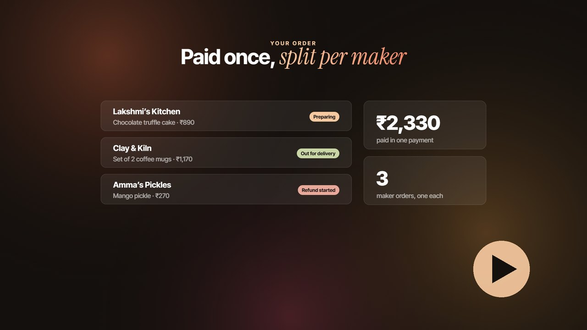](https://youtu.be/nH9BJCr3Dno)

**[▶ Watch on YouTube](https://youtu.be/nH9BJCr3Dno)**

A one-minute explainer: the problem, how one bag works across many makers, one payment split per maker, refunding
just one maker's part, the AI listing helper and what it's built with.

Want to see the real app in action? The **[83-second walkthrough (YouTube)](https://youtu.be/J-GBse7W6Ns)** shows a
complete purchase from two makers with a Razorpay **test** payment, a partial refund and the seller side, recorded on
a local test copy with the demo shops (made-up names, masked phone numbers). Both videos use music made for them.

## Screenshots

| | |
|---|---|
| 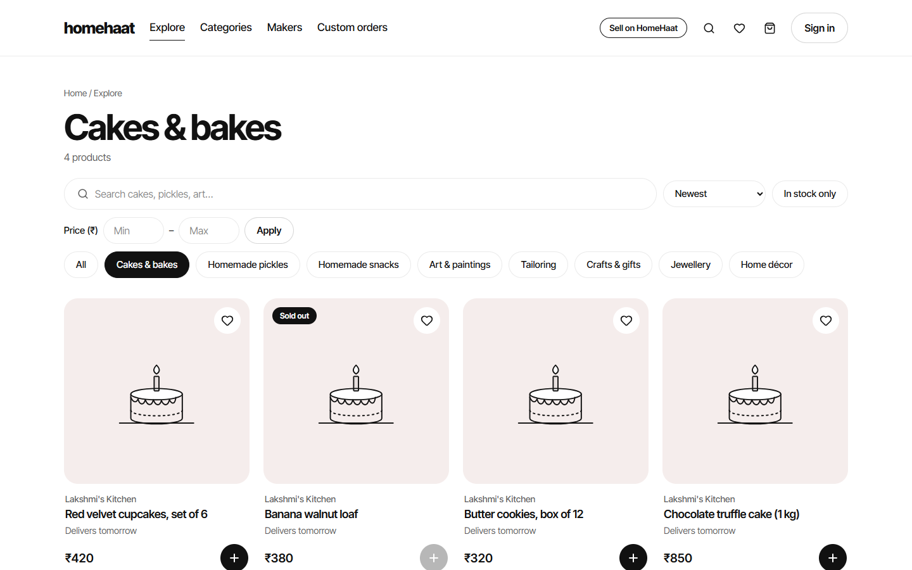 **Search and categories** | 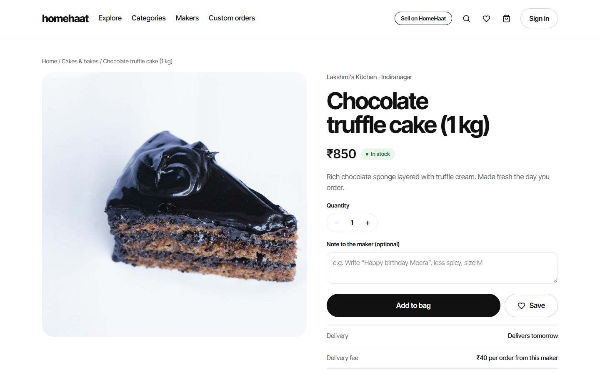 **Product page** |
| 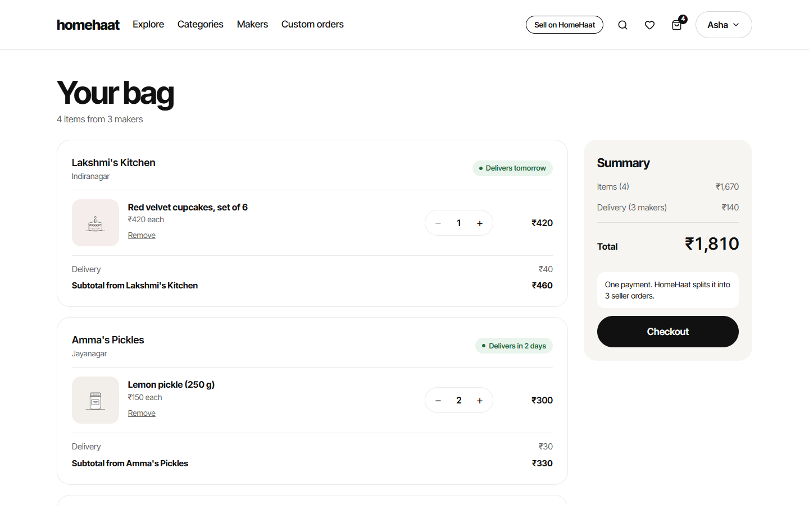 **One bag, many makers** | 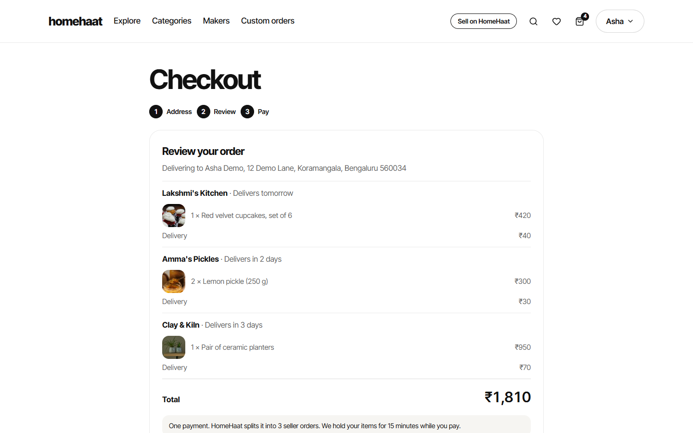 **Checkout: one payment, split per maker** |
| 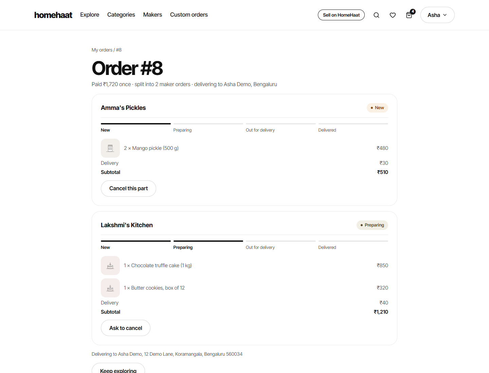 **Order: each maker's progress, cancel per part** | 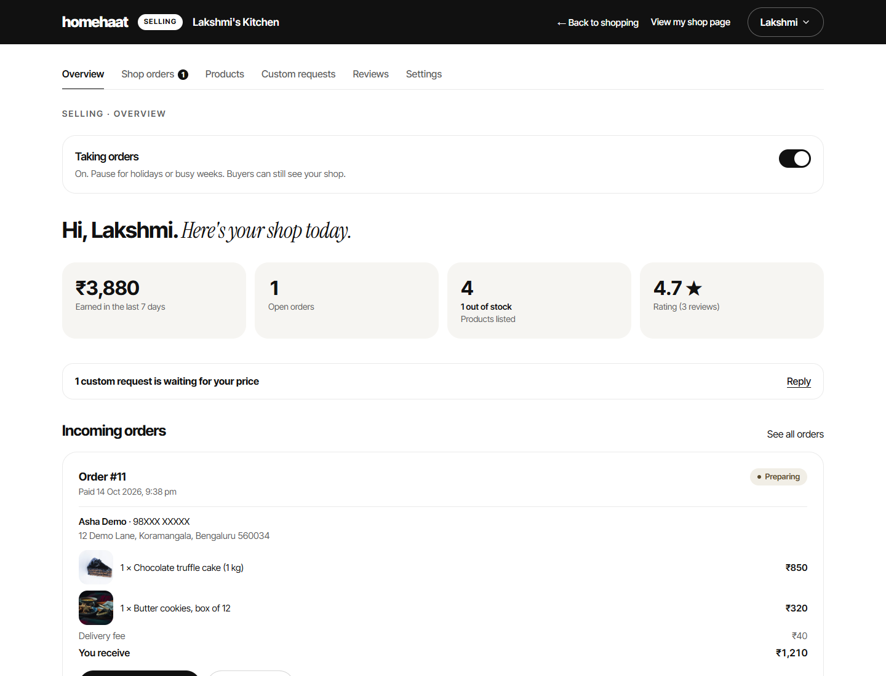 **Seller overview** |
| 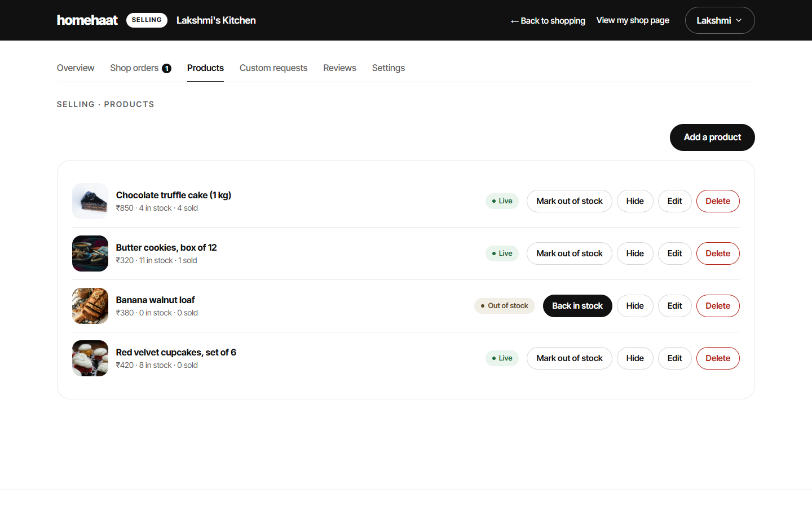 **Seller products: out of stock, hide, edit** | 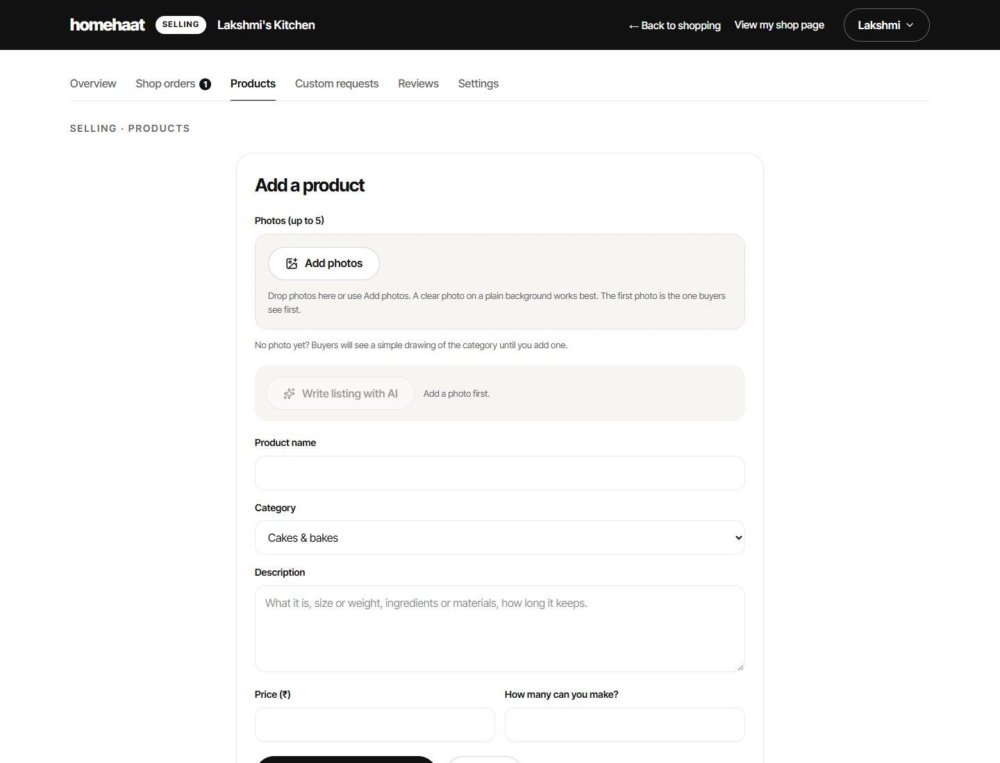 **Add a product, with the AI listing helper** |

On a phone:

  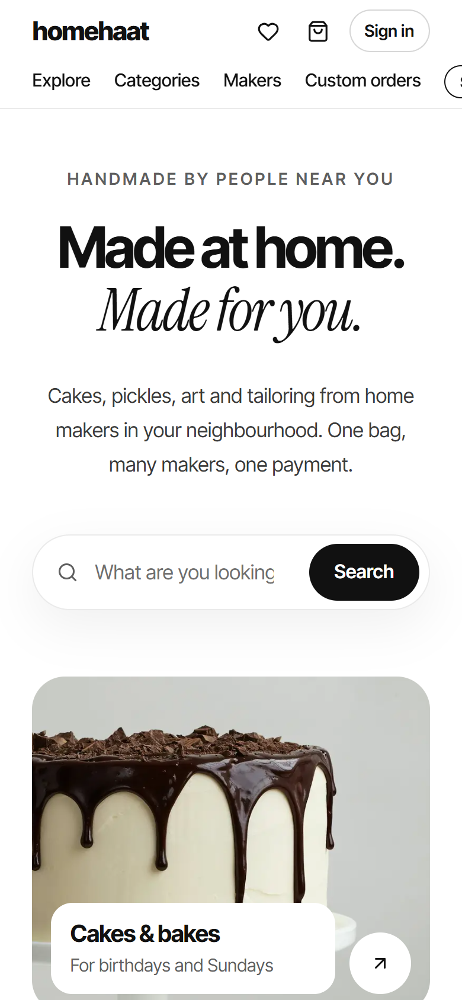
  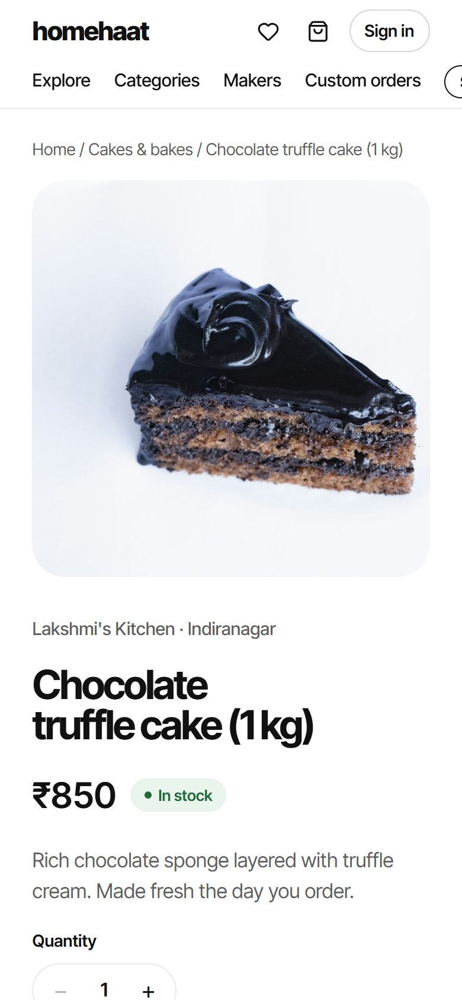
  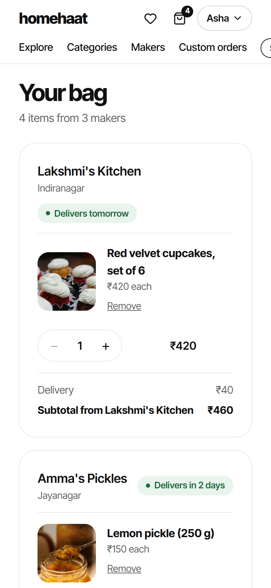
  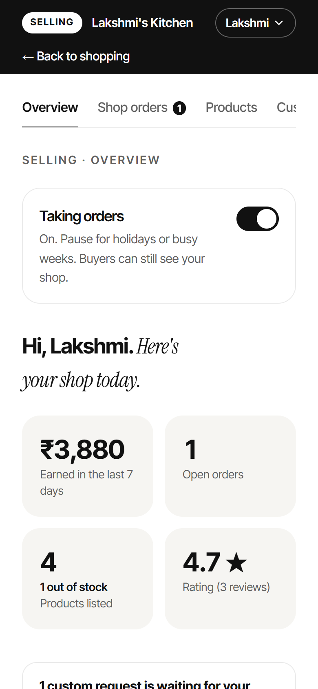

All names, shops and addresses in the screenshots are made-up demo data.

Photo credits: [Unsplash](https://unsplash.com) (free under the Unsplash License); photographers are listed in
[backend/catalog/showcase/CREDITS.md](backend/catalog/showcase/CREDITS.md).

## Features

**For buyers**
- Search with plurals, partial words and "Did you mean…?", plus category, price and stock filters (all kept in the URL)
- One bag across many makers, also for signed-out visitors (merged on sign-in)
- One payment for the whole bag, split into one order per maker, each with its own delivery fee
- Custom requests ("a jungle-theme cake for Saturday") with reference photos: the maker quotes, the buyer accepts
  and it goes into the bag
- Order tracking per maker (New → Preparing → Out for delivery → Delivered)
- Cancel one maker's part of an order and get exactly that part refunded
- Reviews, only after a delivery from that maker

**For sellers**
- Open a shop in a minute: name, link, cover photo, delivery fee and days
- Products with up to 5 photos, resized in the browser and cleaned on the server (no GPS location kept)
- An **AI listing helper** (Google Gemini) that drafts a title and description from the photo, without inventing
  prices, sizes or ingredients
- Shop orders with one-tap next steps, cancellation requests and refund status
- Mark out of stock / back in stock, hide products, and a "Taking orders" switch for holidays
- An overview with real earnings, open orders, stock and rating

## Tech stack

| Part | Built with | Hosted on (free plans) |
|---|---|---|
| Website | Next.js 16 (App Router), React 19, TypeScript, Tailwind CSS v4 | Vercel |
| API | Python 3.14, Django 5.2, Django REST Framework, gunicorn, WhiteNoise | Render |
| Database | PostgreSQL (full-text search) | Neon |
| Photos | Cloudinary (private photos as authenticated assets) | Cloudinary |
| Payments | Razorpay (test mode): Orders API, Checkout, webhooks, partial refunds | Razorpay |
| AI | Google Gemini (Flash-Lite, then Flash as a backup) | Google AI Studio |
| Scheduled jobs | GitHub Actions (hourly) | GitHub |

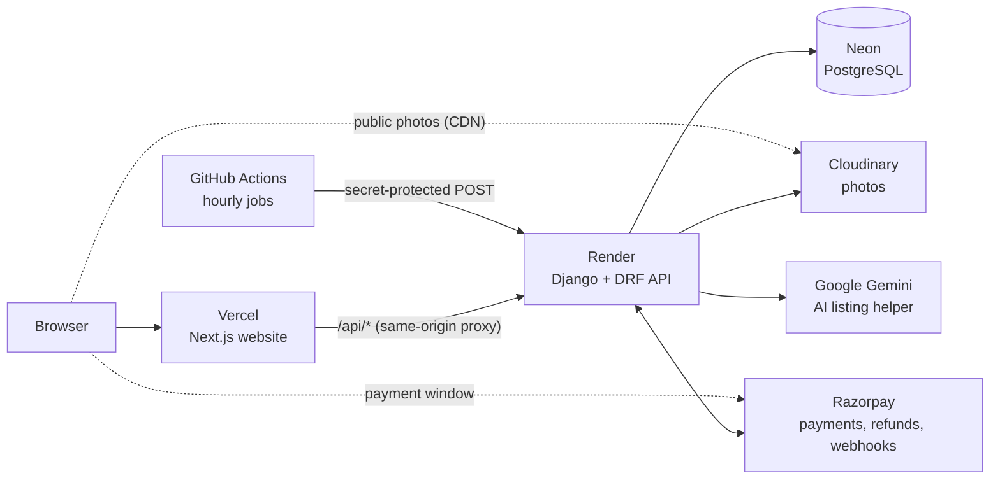

The browser only ever talks to the website. Next.js forwards `/api/*` to Django, so the session cookie is
first-party and httpOnly, and no CORS is needed.

## Interesting engineering

- **One payment, split per shop.** Checkout turns the bag into one `Order` (one Razorpay payment) with one
  `SellerOrder` per maker, each with its own subtotal and delivery fee. Prices always come from the database, never
  from the request. ([`orders/services.py`](backend/orders/services.py))
- **15-minute stock holds without overselling.** Checkout locks the product rows with `select_for_update()` inside
  one transaction, checks stock and holds it straight away. A two-thread test makes two buyers race for the last
  item: one wins, the other gets "sold out", and stock never goes below zero. Unpaid holds are released after
  15 minutes. ([`orders/tests/test_race.py`](backend/orders/tests/test_race.py))
- **Payments verified by signature.** An order becomes paid only on the server, after an HMAC-SHA256 check of
  Razorpay's signature (constant-time compare) and an amount check. Webhooks are checked against the raw body, and
  marking an order paid is idempotent, so retried webhooks change nothing.
  ([`payments/webhook.py`](backend/payments/webhook.py))
- **Idempotent partial refunds.** Cancelling one maker's part refunds exactly that part (items + its delivery fee) on
  the single payment. The database allows one refund per part, Razorpay is called only after the transaction
  commits, and a retry first looks for a refund Razorpay already made, so money is never refunded twice.
  ([`orders/cancel.py`](backend/orders/cancel.py), [`payments/refunds.py`](backend/payments/refunds.py))
- **Private photos via signed URLs.** Custom request photos are visible only to that buyer and that maker. They are
  stored as Cloudinary authenticated assets; the browser only gets HomeHaat's own URL, Django checks who is asking
  and fetches the photo server-side with a signed URL. Everyone else gets a 404.
  ([`core/media.py`](backend/core/media.py), [`core/storage.py`](backend/core/storage.py))
- **Handling a sleeping free server.** The free API sleeps after 15 idle minutes. Reads retry automatically while it
  wakes, and the Pay button first wakes the server with a database-free health check ("Waking up the server…") before
  creating the order. Scheduled jobs run free through a secret-protected endpoint called by GitHub Actions, and also
  lazily on page loads and at every checkout. ([`frontend/lib/api/wake.ts`](frontend/lib/api/wake.ts),
  [`core/jobs.py`](backend/core/jobs.py))
- **An AI helper that can't invent facts.** Gemini must answer with a strict JSON schema that has no price field,
  and the answer is validated again: sentences with prices, sizes or ingredient claims the seller didn't write are
  removed. The seller always reviews the suggestion. ([`ai/listing.py`](backend/ai/listing.py))
- **Money in integer paise.** ₹450 is stored as `45000` everywhere, with one formatting helper, so there are no
  rounding errors.

The plain-English explanations of each of these are in [`CLAUDE.md`](CLAUDE.md) ("How it works").

## Run it locally

You need Docker Desktop, Node.js (LTS) and Python 3.14 on Windows.

1. Clone the repository.
2. Double-click **`Start HomeHaat.bat`** (or run `.\start-homehaat.ps1` in PowerShell). It starts PostgreSQL in
   Docker, installs the packages, sets up the database and opens the API (port 8000) and the website (port 3000).
3. Open <http://localhost:3000>.

For payments, add Razorpay **test** keys to `.env` ([docs/razorpay-setup.md](docs/razorpay-setup.md)). The AI helper
is optional ([docs/ai-setup.md](docs/ai-setup.md)).

Tests: `backend\.venv\Scripts\python.exe backend\manage.py test` (Django, 300+ tests) and `npm test` in `frontend`.

Putting it online for free (Neon, Cloudinary, Render, Vercel, GitHub Actions): [docs/deploy.md](docs/deploy.md).

## How it was built

I built HomeHaat with [Claude Code](https://claude.com/claude-code) as my AI pair-programmer: I set the product
brief, design direction and rules (real data only, money in paise, test mode only, tests for every key piece of
logic), made the decisions at each stage, and reviewed and tested the results.
