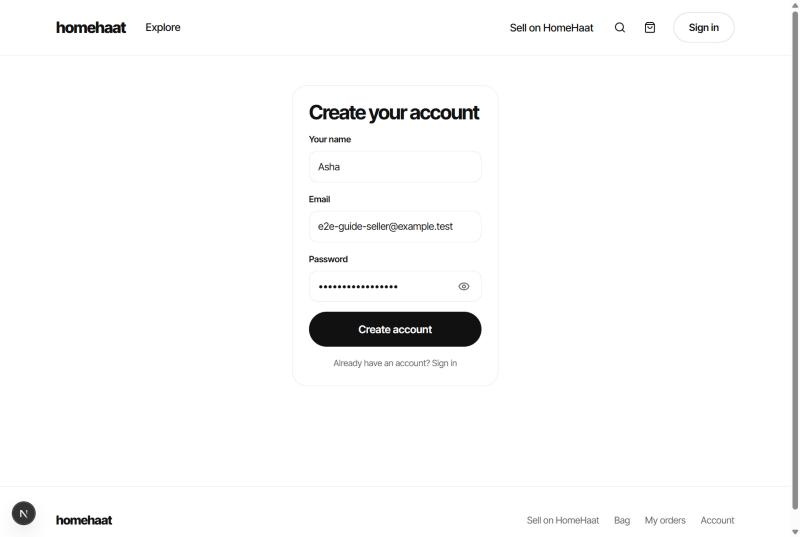
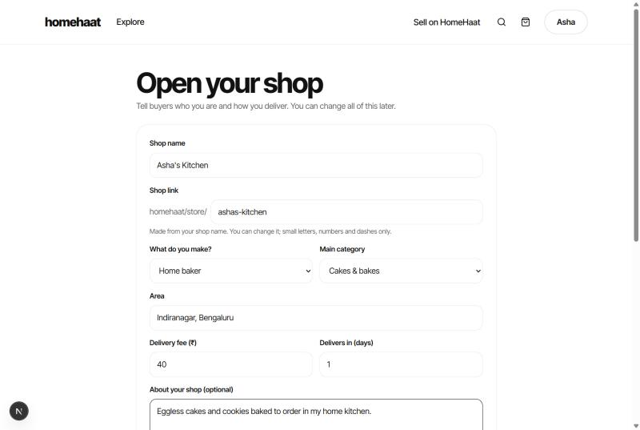
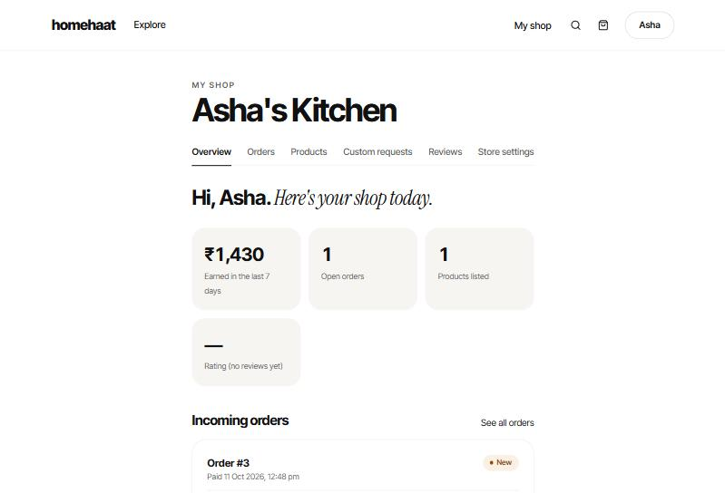
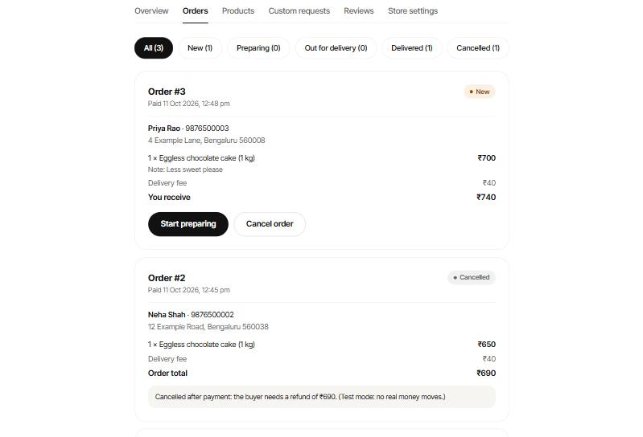

# Selling on HomeHaat: a simple guide

Thank you for trying HomeHaat! This guide shows how to open your shop, add what you make, and handle orders.
It takes about 10 minutes. You can change everything later.

> **This is a test version.** Payments are in *test mode*: no real money moves yet. Please try everything and tell
> Rasmitha what was confusing or didn't work. That's the most helpful thing you can do.
>
> The names and photos in the pictures below are examples.

---

## 1. Create your account

1. Open the HomeHaat link Rasmitha sent you.
2. Click **Sell on HomeHaat** at the top.
3. Click **Create an account**. Type your name, your email and a password (at least 8 characters, not only numbers,
   and not a very common one like *password123*).
   Click the eye icon to see what you typed.
4. Click **Create account**.

---

## 2. Open your shop

You'll see **Open your shop**. Fill in:

- **Shop name**: for example *Asha's Kitchen*.
- **Shop link**: filled in for you from your shop name. You can change it (small letters, numbers and dashes only).
- **What do you make?** and **Main category**: for example *Home baker* and *Cakes & bakes*.
- **Area**: your neighbourhood and city, so buyers know you're near them.
- **Delivery fee** and **Delivers in (days)**: what you charge to deliver, and how many days you usually need.
  Use **0** days if you can deliver the same day.
- **About your shop**: a line or two about you and what you make (you can leave this empty).
- **Cover photo**: a wide photo for the top of your shop page (you can add it later).

Click **Open my shop**.

---

## 3. Add your first product

Right after opening your shop, you'll see **Add a product**.

1. **Photos**: click **Add photos** (or drag photos from your computer onto the box). You can add up to 5.
   - Use the **← →** arrows under a photo to change the order. The first photo (marked **Main**) is the one buyers
     see first.
   - Click the **×** to remove a photo.
   - Big phone photos are made smaller automatically, so they upload quickly. We also remove the hidden location
     information that phones save inside photos, so your home address stays private.
2. **Product name**: for example *Eggless chocolate cake (1 kg)*.
3. **Category**.
4. **Description**: what it is, the size or weight, ingredients or materials, and how long it keeps.
5. **Price (₹)**: the price of one, for example *650*.
6. **How many can you make?**: how many you can sell right now. When it reaches 0, buyers see **Sold out**.

Click **Save and show in my shop**. Your product is now live for buyers.

**Tip:** a clear photo in daylight, on a plain background, sells best.

---

## 4. Your shop dashboard

Click **My shop** at the top at any time. You'll see the tabs **Overview · Orders · Products · Custom requests ·
Reviews · Store settings**.

**Overview** shows:
- **Earned in the last 7 days**: money from paid orders, including delivery fees (cancelled orders aren't counted).
- **Open orders**: orders you still need to prepare or deliver.
- **Products listed**: products buyers can see right now.
- **Rating**: your average review. It shows **—** until a buyer reviews you.

Below that are your newest **incoming orders**.

---

## 5. Handling an order

When a buyer pays, the order appears under **Orders** (and on the Overview). Each order shows:
- the buyer's **name, phone number and address** (only you, the seller, can see these);
- what they ordered, and any **note** they wrote (for example *"Write Happy Birthday Meera"*);
- **You receive**: the price of the items plus your delivery fee.

Move the order along by pressing **one button at a time**:

| The order is… | Press | It becomes… |
|---|---|---|
| New | **Start preparing** | Preparing |
| Preparing | **Mark out for delivery** | Out for delivery |
| Out for delivery | **Mark delivered** | Delivered |

The buyer sees each step on their order page.

Use the buttons at the top (**All, New, Preparing…**) to see only some orders.

### If you can't make an order

Press **Cancel order** (only possible while it's *New* or *Preparing*). HomeHaat asks **"Cancel order #…?"**. Press
**Yes, cancel it** to confirm, or **Keep it** to go back. When you cancel:
- the buyer sees it's cancelled and that they'll get their money back;
- the items go back into your stock automatically.

Cancelling can't be undone, so please only cancel if you really can't make it.

---

## 6. Changing your products

Open **Products**:
- **Hide** takes a product off your shop without deleting it (for example when you're out of an ingredient).
  **Show** puts it back.
- **Edit** lets you change the photos, name, description, price or how many you can make.
- Each product shows how many you have **in stock** and how many you've **sold**.

---

## 7. Custom requests ("can you make…?")

Buyers can ask you to make something special, for example *a photo cake for Saturday*, from your shop page.
When someone does, your **Overview** shows "1 custom request is waiting for your price".

Open **Custom requests**. Each request shows what they want, any reference photos (tap to see them bigger), the
date they need it by and their budget, if they gave one.

- **Send quote**: type your price in rupees and, if you like, a short note (*"Includes the edible photo. Ready
  Saturday 4 pm."*). Your delivery fee is added at checkout, so don't include it.
- **Decline**: if you can't make it. HomeHaat asks you to confirm.

The buyer then accepts or declines your price. If they accept, it goes into their bag and they pay at checkout like
any order. Once paid, it appears under **Orders** as *Custom: …*, and you handle it with the same buttons as any
other order.

You can't change a price after sending it, so check it before you press **Send quote**.

---

## 8. Store settings and pausing your shop

Open **Store settings** to change anything from when you opened your shop: name, shop link, delivery fee and days,
description and cover photo.

Going on holiday or too busy? Tick **Pause my shop** and click **Save changes**. Buyers won't see your products and
can't order until you untick it. Orders you already have are not affected. While paused, your dashboard shows
**Paused: buyers can't order**.

---

## Questions

**When do I get paid?** In this test version no real money moves. In the real version, buyers pay online when they
order.

**Can I buy from my own shop?** No. HomeHaat stops you, so test orders need a second account (a family member's
email works).

**Reviews?** Coming soon: buyers will be able to review your shop after delivery.

**Something didn't work?** Please send Rasmitha a message with what you clicked and what you saw. A phone photo of
the screen is perfect.
